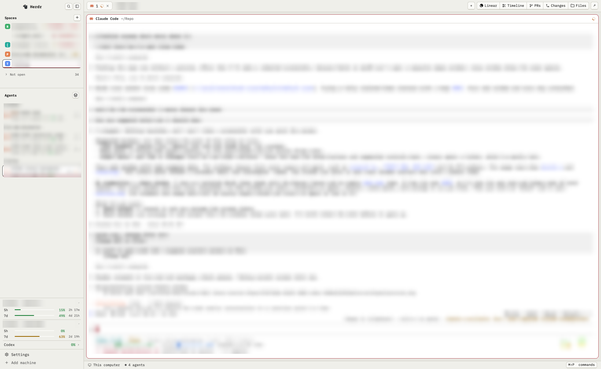

# Maroon

A complete Herdr App setup: one layout, its theme, its keys, and every mod it uses, each one an editable `my-*` copy. Copy it into `~/.config/herdr-app` and change anything.



To install, paste this into a coding agent on the machine that runs Herdr:

```
Add the Herdr layout at https://github.com/RKPinata/herdr-maroon to my Herdr app.
Follow "Layouts and mods other people made" in ~/.config/herdr-app/AGENTS.md.
Read README.md and RECIPE.md first, then:
- Rename the repo's my-* mods with scripts/rename-prefix.sh if any name clashes with my mods.
- Merge settings.json into mine. Ask before you replace a setting I use.
- Tell me what each mod needs (programs, the Claude Code settings in README.md) and what I am missing.
- Run herdr-app check on each mod, then switch to the maroon layout.
```

`RECIPE.md` describes what you see and how to rebuild it from scratch.

## What is here

| Path | Goes to | What it is |
|---|---|---|
| `layouts/maroon.json` | `~/.config/herdr-app/layouts/` | The window: sidebar, tab bar, panes, side panels |
| `themes/maroon.json` | `~/.config/herdr-app/themes/` | Light theme, accent `#a01d2a` |
| `mods/` | `~/.config/herdr-app/mods/` | 16 `my-*` mods, plus `linear`, `agent-switcher`, `agent-resume` |
| `nvim/` | built by `scripts/install-nvim.sh` | Source of `my-nvim`'s binary and Lua plugin (Rust, MIT, from ChmaraX/herdr-nvim) |
| `settings.json` | merge into `~/.config/herdr-app/settings.json` | Fonts, zoom, theme per appearance |
| `scripts/rename-prefix.sh` | stays here | Renames every `my-*` mod and all references to it |
| `scripts/install-nvim.sh` | stays here | Builds `nvim/` and installs `my-nvim` with its wrapper |

## Install

1. Check for name clashes. If `~/.config/herdr-app/mods/` already has a `my-*` folder with a name used here, rename this package's mods first:
   ```sh
   scripts/rename-prefix.sh my- rk-
   ```
2. Copy the files:
   ```sh
   H=~/.config/herdr-app
   cp layouts/maroon.json "$H/layouts/"
   cp themes/maroon.json "$H/themes/"
   cp -R mods/* "$H/mods/"
   scripts/install-nvim.sh
   ```
3. Merge `settings.json` into yours by hand.
4. Check each mod:
   ```sh
   for m in mods/*; do herdr-app check "$H/mods/${m#mods/}"; done
   ```
5. Switch to the layout with `herdr-app do layout.switch '{"name":"maroon"}'`, or cycle layouts with `cmd-shift-l`.

An agent can do all of this. Point it at this folder and the section "Layouts and mods other people made" in `~/.config/herdr-app/AGENTS.md`.

## What it needs

- **Fonts:** Monaspace Neon (terminal) and IBM Plex Mono (UI).
- **Programs:** `git`, `gh` (signed in), `python3`, `jq`. `node` for Mermaid previews in `my-filer-pro`. `rg` and `fzf` make `my-filer-pro`'s quick open fast (it falls back to `git`, `find` and `grep`). Neovim 0.10+ and Rust (`rustup`) for `my-nvim`.
- **Keys:** no bindings ship. Bind `mod.open:agent-switcher` (for example `ctrl-tab`), `mod.open:agent-resume`, `mod.open:my-nvim` (for example `cmd-e`), `my-nvim.pick` (for example `cmd-o`) and `mod.open:my-filer-pro` (quick open, for example `cmd-k`) in your `keys.json`. Inside the switcher, `agent-switcher.next` and `agent-switcher.prev` move.
- **Projects folder:** `my-spaces` lists repos in `~/Repo`. Set the layout block's `projects` prop to use another folder.
- **Linear:** the `linear` mod reads an API key from the macOS keychain, service `herdr-linear`. It is macOS only.
- **Annotator helper:** `my-annotator` runs `~/.local/bin/herdr-annotator`. Install it from [jakub-tucek/herdr-annotator](https://github.com/jakub-tucek/herdr-annotator).
- **Claude Code:** two mods read data that Claude Code writes. Add this to `~/.claude/settings.json`:
  ```json
  {
    "statusLine": { "type": "command", "command": "sh ~/.config/herdr-app/mods/my-usage/claude-statusline.sh" },
    "hooks": {
      "SessionStart": [
        { "hooks": [ { "type": "command", "command": "python3 ~/.config/herdr-app/mods/agent-resume/agent_resume.py hook claude", "timeout": 10 } ] }
      ]
    }
  }
  ```
  The status line saves rate limits for `my-usage`, then prints the [claude-hud](https://github.com/jarrodwatts/claude-hud) line, which needs `bun`. The hook lets `agent-resume` (`ctrl-shift-r`) find past sessions.

### What reaches outside Herdr

| Mod | Network | Programs and files |
|---|---|---|
| `linear` | api.linear.app | macOS keychain |
| `my-pr-flow`, `my-spaces` | GitHub through `gh` | `git`, `gh` |
| `my-annotator` | GitHub releases of herdr-annotator | `~/.local/bin/herdr-annotator` |
| `my-filer-pro` | GitHub releases, once a day (`update_check: false` turns it off) | archive tools, `ssh`/`scp`, `osascript`, editors |
| `my-agents`, `my-timeline`, `agent-resume` | none | reads `~/.claude/projects`, sends `/clear` and `/rename` to agents |
| `my-usage` | none | reads `~/.cache/herdr-mods/usage`, `~/.codex/sessions` |

## Make it yours

- **Own every mod.** Herdr replaces shipped mods on every start, and third-party mods overwrite themselves on update. Edit only `my-*` copies. To own another mod, run `herdr-app do mod.clone '{"name":"<name>","as":"my-<name>"}'`, then point the layout, every `mod: "<name>"`, every `mods/<name>/` path and every `const MOD` at the copy.
- **Clone of a docked mod.** A clone of a mod with `"place": "right"` adds its own block to the layout. Remove that block and set `place` to `none` in the clone's `mod.json`.
- **Change the colors** in `themes/maroon.json`. Every mod reads them from the theme.
- **Change the buttons** in `boxy.js`. It draws the boxed buttons and segmented controls: outline, face, and a 2px bottom lip that turns accent when active. Each mod that draws buttons has its own copy. Keep the copies the same.
- **Change the prefix** with `scripts/rename-prefix.sh <old> <new>`. It renames folders and references, leaves `cloned_from` alone, and lists any leftovers. Mods that save state under their name start fresh after a rename.

## Credits

Mods here are copies of others' work, each under its own license file in its folder:

- Herdr's shipped mods: `menu`, `toast`, `pane`, `worktree`, `workspace-chrome`, `workspace-status`.
- Over9k (MIT): `agent-switcher` and every mod with a `LICENSE-over9k` file (`my-agents`, `my-spaces`, `my-new-menu`, `my-usage`, `my-timeline`).
- [herdr-pr-flow](https://github.com/jjangsky/herdr-pr-flow): `my-pr-flow`.
- [herdr-annotator](https://github.com/jakub-tucek/herdr-annotator) (MIT): `my-annotator`, `my-annotator-tabs`.
- [herdr-agent-resume](https://github.com/thuanlm215/herdr-agent-resume) (MIT): `agent-resume`.
- [herdr-filerpro](https://github.com/Srv-02/herdr-filerpro): `my-filer-pro`. See `mods/my-filer-pro/THIRD_PARTY_NOTICES.md`.
