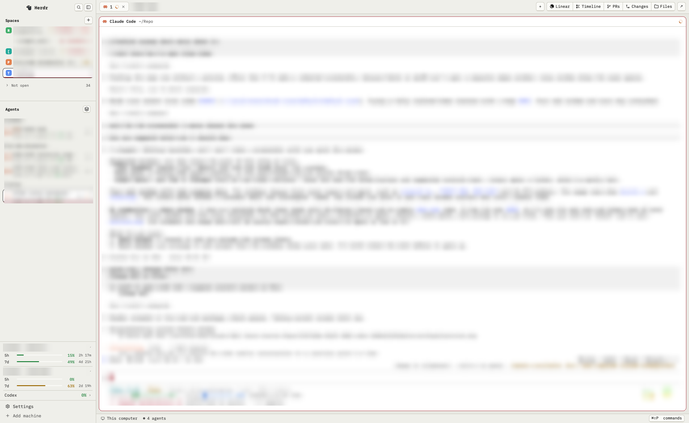

# Maroon

A light Herdr window on warm grey paper with one accent: maroon `#a01d2a`. A sidebar on the left lists spaces, agents and usage limits. On the right sit a tab bar, the shown tab's panes as white cards, a side panel you open from the tab bar (Files, Changes, PRs, Timeline, Linear), and a status bar. Every button is a boxed key with a 2px lip under it. The selected key has a maroon lip. Muted text is near black, `#2e2e2e`, never grey.



## What you see

**Window.** There is no system title bar. On macOS the traffic lights sit at 12, 16 px. Behind everything is `canvas` `#e8e8e2`. Mod text is IBM Plex Mono. Terminals use Monaspace Neon 14.5px, no ligatures. Zoom is 1.1.

**Theme `maroon`** (light):

| name | hex | name | hex |
|---|---|---|---|
| background, surface, popover | `#ffffff` | foreground | `#111111` |
| canvas | `#e8e8e2` | muted | `#2e2e2e` |
| chrome | `#efefea` | dim | `#555555` |
| raised | `#fafaf7` | accent, ring, solid | `#a01d2a` |
| hover | `#e4e4dd` | accent_foreground, solid_foreground | `#ffffff` |
| selected | `#dddcd3` | working | `#b45309` |
| border | `#c4c2b8` | blocked | `#dc2626` |
| input | `#a9a69c` | done | `#2563eb` |
| unknown | `#8a8a8a` | idle | `#6b6b6b` |

Terminal: cursor `#a01d2a`, selection `#f3d3d6`. ANSI 0–15: `#111111 #b3202d #1a7f37 #9a6700 #0b5cad #8b3fb0 #0e7c86 #5a5a5a #454545 #d1242f #2da44e #b58a00 #2f6fd6 #a855c7 #1597a5 #7a7a7a`.

**Boxed keys.** All buttons and segmented controls look the same. Each has a 1px outline, a face, and a 2px lip under the face. Outer corners are 6px, face corners 5px. A press sinks the face 1px.

- **Secondary.** Outline `border`, lip `selected`, face `raised`. The face turns `hover` under the pointer.
- **Active** (a selected toggle). Outline `foreground`, lip `accent`, face `surface`, medium weight.
- **Primary.** Outline and lip `foreground`, face `solid` maroon, white text.

In a segmented group the boxes share one 1px seam. The seam beside the active box is dark. The selected row of a list (the active space, the focused agent) is a card in the same style: 1px `foreground` outline, white face, 2px maroon lip, 8px corners. Other rows keep a clear 1px outline, so selecting never shifts text.

**Sidebar**, left, 268px wide, `chrome`. Top to bottom:

1. **Brand bar, 46px.** Herdr logo (20px, 5px corners), "Herdr" semibold 13.5px, a search key and a sidebar key. On macOS it starts 76px in, after the traffic lights.
2. **Spaces.** Heading "Spaces" (11.5px semibold) with a "+" key. Rows are 30px, 13px text. Each space has an 18px square in its color with its first letter in white bold 10.5px. Colors come from `#22a99a #e3814f #5b8def #8b7cf6 #3fae6a #d9649a`, least used first. A worktree space sits under its main checkout: 28px, indented 22px, a branch icon instead of the square. After the name, in 11.5px `dim`: repo and branch only where unusual (main and master never show). Then counts: uncommitted files (`#9a6700`), ↑ ahead (`#1a7f37`), ↓ behind (`#b3202d`), the branch's PR chip, and on a repo's first row its open PRs, issues and stars. Counts that do not fit drop, stars first. Below the list, a folded "Not open" group lists repos in `~/Repo` with no space. When other machines are known, each gets a header with a server icon and a green or grey dot.
3. **Agents.** 1px border on top. Heading "Agents" with a sort key. Rows are 30px, or 40px for a Claude Code agent with a second line in 11px `dim`: model · effort, a 24×4px context bar with its %, time since the last reply, and a red "exp." once the prompt cache ran out. The bar and % are green, yellow from 50%, red from 80%. Sub-agents, subagents, background shells, monitors and schedules hang under their agent on 26px rows with tree lines. With no agents: "No agent status yet. Agents show up here when they report their status. Older versions and agents inside tmux may not."
4. **Usage**, 62px at first, then as tall as its rows. One 28px row per service: "Claude" (or "Claude · <account>" per account of the account rotator plugin) and "Codex". Each shows time to reset in `dim` and the fullest limit's % in green, yellow from 50%, red from 80%. With nothing: "No usage yet: start Claude Code or Codex".
5. **Footer, 69px.** Two 28px rows with icons: "Settings" and "Add machine" (`dim`).

**Main column:**

1. **Tab bar, 42px**, `chrome`, 1px border below. Tabs are pills 29px tall, 12.8px, 7px corners. The active tab has a `border` outline, a `raised` face and a close ×. Others are flat. Each tab shows its program icon and its name. An unnamed tab shows its program's name. A zoomed tab ends in " Z". Then come a "+" key, a segmented group with icons (Linear, Timeline, PRs, Changes, Files), and a "↗" key.
2. **Work area**, 8px padding, 8px gap. Every pane is a card, even a tab's only pane: white, 1px `border`, 10px corners, 8px apart. The focused pane's border is 1px maroon. Terminal padding is 14px by 12px. Each pane has a 30px header on top, 12px text: program icon, name (medium), folder with `~` (`dim`), status.
3. **Side panel**, right of the panes, 368px (280–900), hidden at start. It shows one of:
   - **Files** (Filer Pro): a file tree of the focused pane's folder with previews, a 42px header and 10px corners.
   - **Changes**: the checkout's diff with line comments, Code / Comments · N / GitHub · N segments, and a primary "Review & send…" key that sends comments to an agent.
   - **PRs**: every PR your agents opened, with checks, reviews and logs. A PR opens in the panel.
   - **Timeline**: the focused Claude Code agent's prompts, newest first, one card each on a vertical line. A working prompt's dot is `#b45309`.
   - **Linear**: My issues, Favorites, Projects, Recent. A ticket opens in the panel.
4. **Status bar, 28px**, `chrome`, 1px border on top, 11.8px `muted`: the machine ("This computer"), the branch, "N agents", and "· N needs you" in red. On the right, a boxed key "⌘⇧P  commands" (the key bound to `app.palette`).

## How it behaves

**Agent status:**

| status | agent row | tab | pane header |
|---|---|---|---|
| working | 12px spinner in `#b45309`, one turn per 900ms; the agent icon fades between 0.4 and 1 over 1.6s | spinner | spinner |
| blocked | "Needs you" pill, 18px, `#dc2626` on 15% red; a 14px "!" square under a "Needs you" heading | 6px red dot | "Needs you" pill |
| done | 7px dot `#2563eb` | 6px blue dot | 7px blue dot |
| idle | 7px ring, 1.5px `#6b6b6b`; name in `muted` | nothing | nothing |

A row's status mark cross-fades over 250ms. The status bar counts blocked agents. In the narrow sidebar a space shows "●" in its status color when blocked or done.

**Sidebar.**

- **Search key** runs `mod.open {name: "picker"}`.
- **Sidebar key** narrows the sidebar to a rail, 76px on macOS and 44px elsewhere, and back to its last width. The rail shows numbered spaces and agents with status marks. On macOS a "»" key under the agents unfolds it.
- **Space row.** A click runs `space.select`. A drag runs `space.move`, only within one machine, with a 2px ink drop line. A right-click opens `my-menu`: Rename, New worktree, Open worktree, Remove worktree (worktrees only), Close. "+" runs `space.new`.
- **Counts.** ↑ asks "push?" and pushes on a second click within 4s. ↓ runs `git pull --ff-only`. PR, issue and star counts open GitHub. A result shows as a toast.
- **Spaces height.** The block grows to its list, up to half the column. After a divider drag, a double-click on "Spaces" fits it again.
- **Agent row.** A click runs `pane.focus`. On hover a pin icon appears (`terminal.pin`); pinned agents go first under "Pinned". The sort key opens Priority (sections Needs you, Done, Working, Idle) or Grouped by space. Headers fold their group. Hovering an agent with an expired cache shows a red "clear + recap" pill. A click renames the old session "[Cleared] <name>", sends `/clear`, and asks the agent to read the old transcript. The new session takes the name the agent gives in its reply.
- **Usage row.** A click opens a 3px bar per limit with its % and reset time.
- **Footer.** "Settings" runs `app.settings` and carries a 6px maroon dot when an app update is ready. "Add machine" runs `mod.open {name: "machine-add"}`.

**Tab bar.**

- **Tab.** A click runs `tab.select`. A double-click runs `tab.rename`. A drag runs `tab.move`. A right-click opens `my-menu`: Rename, New tab, Close. The wheel runs `tab.prev` / `tab.next`. × runs `tab.close`.
- **"+"** opens `my-new-menu` (250×512 popup): Terminal, Start an agent (installed agents, keys 1–9), Resume a session (Claude Code and Codex sessions of the space's folder), New space, New worktree…, Open worktree….
- **Files** (`my-filer-pro`). A click on a text or markdown file opens it in the tab's nvim (`my-nvim open --tab`), and so does the viewer's Edit key. Images, PDFs and HTML open in the viewer. Without `my-nvim` installed, the viewer shows every file.
- **Panel segment.** A click runs `layout.select {stack: "panel-body", child}` and `layout.show {id: "panel"}`. Clicking the active segment runs `layout.hide`. Each space remembers its panel.
- **"↗"** opens a "Review" tab with the full Changes review, or goes to the one already open.

**Panes.** A header click runs `pane.focus`. On hover the header shows split right, split down, zoom and close keys (`pane.split`, `pane.zoom`, `pane.close`). A terminal right-click opens `my-menu`: Split right, Split down, Zoom, Send right-clicks to pane, Send back to <parent>, Move to… (space, then tab), Close pane. ↑/↓ move, Enter runs, Esc closes.

**nvim** (`my-nvim`). Each tab has one persistent nvim, started with the person's own `~/.config/nvim`. `mod.open:my-nvim` opens it as a full-height pane right of the tab's panes, or puts it away. Put away, it keeps running, so buffers, cursor and language servers come back as they were. Closing the tab stops it. `my-nvim.pick` opens an 820×470 dialog listing the files the tab's agent read and edited, newest first, then uncommitted git changes; typing fuzzy-searches the repo, and ⏎ opens the file in nvim. In nvim, `ctrl-k` then `c` comments the line or selection, `l` lists comments, `s` pastes them into the agent's input, `S` sends them, `i` puts `path:line` at the agent's cursor. These keys work in insert and select mode. On nvim's pane header, a Preview key shows a markdown file, image or SVG rendered in nvim's place; Source (nvim for an image) brings nvim back.

**Toasts** (`my-toast`): a dot by level (error red, warning `#b45309`, success blue, info maroon), title 13px semibold, body 12px. A click runs its action. A "needs login" toast shows the `hc machine login` command with a Copy key.

**Keys.** No bindings ship.

- `mod.open:agent-switcher` opens the agent switcher, a 460px dialog of agents, most recent first. Bound to `ctrl-tab`, holding Ctrl and pressing Tab or Shift+Tab moves (`agent-switcher.next`, `agent-switcher.prev` in a `mod:agent-switcher` section). Releasing Ctrl runs `agent.focus`.
- `mod.open:my-nvim` opens or puts away the tab's nvim (`cmd-e` here). `my-nvim.pick` opens the agent's files (`cmd-o` here).
- `mod.open:agent-resume` opens Agent resume. It types `claude --resume <id>` or `codex resume <id>` into each terminal that lost its agent and sits at a shell, then reports in a toast.

## Built from

```
root row          bg canvas · divider 1 border · titlebar none · traffic_lights [12,16]
                  terminal_padding [14,12] · terminal_menu my-menu · toast my-toast
├─ sidebar column 268px (min 44, max 480) · bg chrome · resizable false
│  ├─ brand            my-workspace-chrome                    46px · window_drag
│  ├─ sidebar-lists column
│  │  ├─ spaces        my-spaces                              weight 1 · min 90
│  │  └─ agents        my-agents                              weight 1 · min 90
│  ├─ usage            my-usage                               62px
│  └─ sidebar-footer   my-workspace-chrome {footer: true}     69px
└─ work column · resizable false
   ├─ tab-bar row 42px · resizable false
   │  ├─ tabs              my-annotator-tabs                  weight 1 · window_drag
   │  └─ filer-pro-button  my-filer-pro {button, listen}      0px
   ├─ work-body row · padding 8 · gap 8
   │  ├─ main   {tab: "active"} with the pane frame below
   │  └─ panel column 368px (min 280, max 900) · hidden
   │     └─ panel-body stack · active filer-pro
   │        ├─ filer-pro  my-filer-pro                        weight 1 · min 120
   │        ├─ changes    my-annotator
   │        ├─ prs        my-pr-flow {merge: "merge"}
   │        ├─ timeline   my-timeline
   │        └─ linear     linear
   └─ status   my-workspace-status                            28px
floating
└─ my-nvim-sync  my-nvim {role: "sync"}  edge bottom · align end · no size
```

Pane frame on `main`:

```json
{ "background": "background", "border": { "width": 1, "color": "border" },
  "focus": { "width": 1, "color": "accent" }, "radius": 10, "gap": 8, "lone": true,
  "header": { "content": { "mod": "my-pane" }, "height": 30, "position": "top", "reveal": "always" } }
```

**Look.** The layout sets no theme or fonts. `settings.json` does: `"appearance": "light"`, `"theme": {"light": "maroon", "dark": "graphite"}`, `"font": "Monaspace Neon"`, `"font_size": 14.5`, `"font_ligatures": false`, `"ui_font": "IBM Plex Mono"`, `"zoom": 1.1`, `"minimum_contrast": 1`. The theme is `themes/maroon.json`.

**`boxy.js`.** One 40-line file exports `boxy(t, id, content, {kind, onClick, h, px, size, gap, disabled, l, r, rl, rr})` and `card(t, el, on, radius)`. It draws every boxed key and selected-row card above. Mods import it as `./boxy.js`, so each mod that draws keys holds an identical copy: `linear`, `my-agents`, `my-annotator`, `my-annotator-tabs`, `my-filer-pro`, `my-nvim`, `my-pane`, `my-pr-flow`, `my-spaces`, `my-toast`, `my-workspace-chrome`, `my-workspace-status`.

**Mods, and what each runs:**

| mod | role | programs, files, network |
|---|---|---|
| my-workspace-chrome | brand bar; footer with `props.footer` | none |
| my-spaces | spaces list | `git` (status, rev-parse, remote, push, pull); `gh` (`api user`, `repo view`, `pr list`) every 5 min per repo; `find` in `~/Repo`; `hc machine ls` |
| my-agents | agents list | `python3 -I claude-info.py` every 5s while a Claude Code agent runs (reads `~/.claude`, writes `~/.cache/herdr-mods/agents`); `hc send` for clear + recap |
| my-usage | usage rows | `sh` reading `~/.codex/sessions` and `~/.claude/plugins/store/account-rotator_*.json`; reads `~/.cache/herdr-mods/usage/claude.json`; every 30s |
| my-annotator-tabs | tab bar | `herdr-app do tab.new` for "↗" |
| my-pane | pane header; Preview / Source on my-nvim's panes | `mods/my-nvim/bin/my-nvim app-current` on an nvim pane |
| my-filer-pro | Files panel; with `button` + `listen` it draws nothing, adds `filer-pro` to shared `workspace.panels` and answers `reveal` while the panel is hidden | `sh`, `git`, `rm`, `mkdir`; reads, writes, moves and deletes files where you browse; once a day `fetch` of `api.github.com/repos/Srv-02/herdr-filerpro/releases/latest` (setting `update_check`, on by default) |
| my-annotator | Changes panel and the full Review tab | `~/.local/bin/herdr-annotator request <json>` (ops `snapshot`, `ask`, `order`, `order_models`, `github_read`, `github_reply`); `python3 ~/.local/share/herdr-annotator/update.py`; `herdr-app do tab.new` |
| my-pr-flow | PRs panel; `merge: "merge"` turns on a merge key (two presses) | `gh` (api, graphql, `pr`), `git`, `ssh -G`, `open`; posts a PR comment or merges only on your press; once a day `gh api repos/jjangsky/herdr-pr-flow/releases/latest` |
| my-timeline | Timeline panel | `python3 -I prompts.py` on the transcript; `hc read` for the live spinner line |
| linear | Linear panel | `security find-generic-password -s herdr-linear`; `fetch` to `https://api.linear.app/graphql`, including issue updates, comments and favorites; `hc send` to an agent; `tab.new` with an agent's argv |
| my-workspace-status | status bar | none |
| my-menu | right-click menus (terminal, tab, space) | `git rev-parse`; `hc get` / `hc label` to move a terminal |
| my-new-menu | "+" popup | `sh` with `jq` over `~/.claude/projects`, `sqlite3` over `~/.codex/state_5.sqlite`; `knownAgents()` |
| my-worktree | New / Open / Remove worktree dialogs | `git worktree add/list/remove`; new worktrees go to `~/.herdr/worktrees/<repo>/<branch>` |
| my-toast | notifications | none |
| my-nvim | the tab's nvim: the `my-nvim-sync` block takes `my-nvim.pick` and the Preview / Source swap; an overlay for `mod.open:my-nvim`; the picker's title bar; the preview pane; the welcome and "Neovim is needed" cards | `mods/my-nvim/bin/my-nvim`, a wrapper `scripts/install-nvim.sh` writes around the binary built from `nvim/`. It runs one headless `nvim` per tab, `hc`, `git`, and reads the agent's session logs (Claude Code, pi). No network |
| agent-switcher | `ctrl-tab` dialog | none |
| agent-resume | `ctrl-shift-r` popup | `python3 agent_resume.py resume`, which runs `hc`, `ps`, `sysctl` |

**Herdr calls.** Commands: `space.select`, `space.move`, `space.new`, `space.close`, `space.rename`, `tab.select`, `tab.move`, `tab.new`, `tab.rename`, `tab.close`, `tab.prev`, `tab.next`, `pane.focus`, `pane.split`, `pane.zoom`, `pane.close`, `agent.focus`, `terminal.pin`, `terminal.peek`, `terminal.park`, `terminal.right_click`, `layout.resize`, `layout.select`, `layout.show`, `layout.hide`, `mod.open`, `app.settings`, `app.palette`. Shared values: `workspace.panels`, `space.colors`, `sidebar.width`, `sidebar.collapsed`, `agents.sort`, `annotator.fullTabs`, `agent-switcher.recent`, `new-menu.agents`.

**Art.** SVG icons in `mods/my-workspace-chrome/` (31, shared by most mods), `mods/my-pane/` (split, zoom, close), `mods/my-spaces/` (issue, pull-request, star), `mods/my-pr-flow/`, `mods/my-filer-pro/`, `mods/my-timeline/timeline.svg`, `mods/linear/linear.svg`. From the app: `frame/welcome/herdr.png`, `icons/shell.svg`, `icons/agent.svg`, `icons/claude.svg`, `icons/codex.svg`, `mods/changes/changes.svg`, `mods/workspace-chrome/spinner.svg`, `mods/tabs/win-*.svg`.

## Watch out

- **The look lives in settings.json.** The layout root has no `theme`, `font` or `ui_font`. Merge the settings above, or the build shows `paper` and Herdr's fonts. `themes/maroon.json` shares the layout's name, so Settings offers it only on this layout.
- **Fonts are not shipped.** Install Monaspace Neon and IBM Plex Mono. A missing terminal font falls back to JetBrains Mono.
- **Keep `boxy.js` identical.** Twelve mods hold a copy. A change to one must go to all.
- **Paths cross mods.** Most mods load icons from `mods/my-workspace-chrome/`. The tab bar loads `mods/my-pane/close.svg` and each panel mod's icon. A name clash breaks these paths. `scripts/rename-prefix.sh my- <new-prefix>` renames every `my-*` mod and rewrites every reference.
- **Block ids are fixed.** The tab bar reads `sidebar`, `panel`, `panel-body` and the stack children `filer-pro`, `changes`, `prs`, `timeline`, `linear`. A segment shows only when its child exists. Changes shows only while shared `workspace.panels` holds `changes` (default `["files", "changes"]`).
- **Blocks size themselves.** `my-spaces` and `my-usage` call `layout.resize` on their own block. The spaces fit ignores gaps and dividers, so do not add any to the sidebar.
- **Outside helpers.** Changes needs the `herdr-annotator` binary at `~/.local/bin/herdr-annotator` and its `update.py`, from `github.com/jakub-tucek/herdr-annotator`. Linear needs a key in the macOS Keychain: `security add-generic-password -U -s herdr-linear -a "$USER" -w`. PRs and the spaces' GitHub counts need `gh` logged in. Agents, Timeline and Agent resume need `python3`. Resume sessions need `jq` and `sqlite3`.
- **Claude usage needs a status line.** The Claude row reads what `mods/my-usage/claude-statusline.sh` writes. Set it as Claude Code's `statusLine` command. It then runs the claude-hud plugin with `bun` from PATH, else `~/.bun/bin/bun`.
- **Agent resume needs hooks.** `resume` acts on terminals labeled by `agent_resume.py hook <agent>`. Without the hooks it finds only Claude Code sessions it can adopt from `~/.claude/sessions`.
- **my-nvim is built, not copied.** `scripts/install-nvim.sh` builds `nvim/` with cargo, puts the runtime in `~/.local/share/my-nvim/app/<stamp>`, copies `mods/my-nvim` and writes its `bin/my-nvim` wrapper. A plain `cp -R mods/*` leaves the mod without that wrapper. A tab's nvim keeps the runtime it started with until its tab closes. Settings live in `~/.config/my-nvim/config.toml`.
- **Projects folder.** "Not open" scans `~/Repo`. A `projects` prop on the `spaces` block changes it.

## Done when

- `herdr-app check` passes for every mod, and `layout.switch {"name": "maroon"}` shows the window with no system title bar.
- The canvas is `#e8e8e2`, the sidebar `#efefea`, the panes white with 10px corners and a 1px maroon border on the focused one.
- The active space and the focused agent each draw as a card with a dark outline and a 2px maroon lip.
- Every key has a 2px lip. The open panel's segment has a maroon lip. Pressing a key sinks its face 1px.
- Muted text renders `#2e2e2e` and dim text `#555555`.
- A working agent shows a turning `#b45309` spinner in its tab, its pane header and its row. A blocked one shows "Needs you" and raises "· 1 needs you" in the status bar.
- Clicking Files, Changes, PRs, Timeline or Linear opens that panel at 368px. Clicking it again hides the panel. Switching spaces brings back each space's panel.
- The sidebar key folds the sidebar to 76px on macOS (44px elsewhere) and back to its last width.
- Right-clicking a terminal opens `my-menu` with "Split right" first. Toasts come from `my-toast`.
- `cmd-e` opens the tab's nvim beside its panes. `cmd-e` again puts it away, and the next `cmd-e` brings back the same buffers at once. A text file clicked in Files opens in it.
- `cmd-o` over an agent that edited files lists them newest first. ⏎ opens one in nvim.
- `ctrl-k c` in nvim, typed in insert mode, then `ctrl-k S`: the agent gets the comment with its `file:line`.
- `ctrl-tab` opens the agent switcher. Releasing Ctrl focuses the picked agent.
